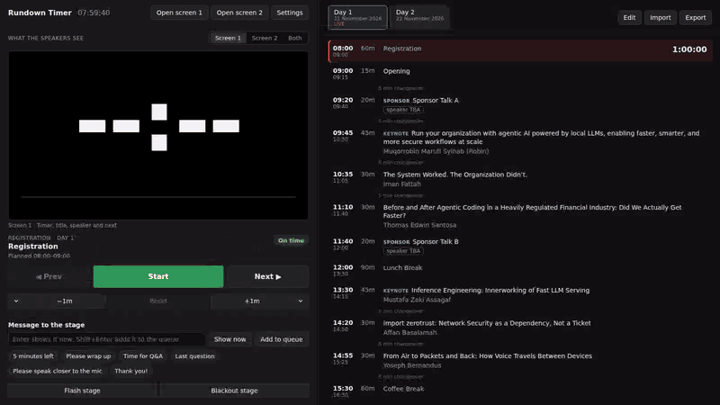
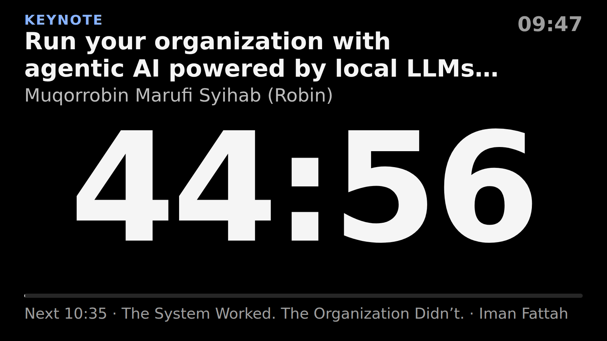
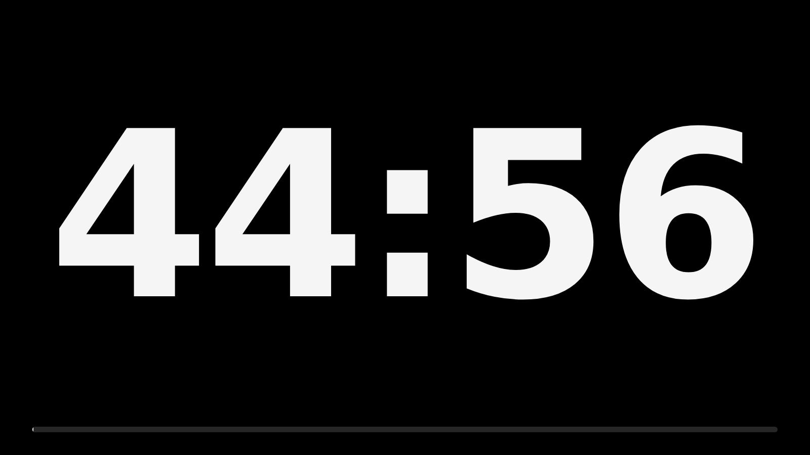
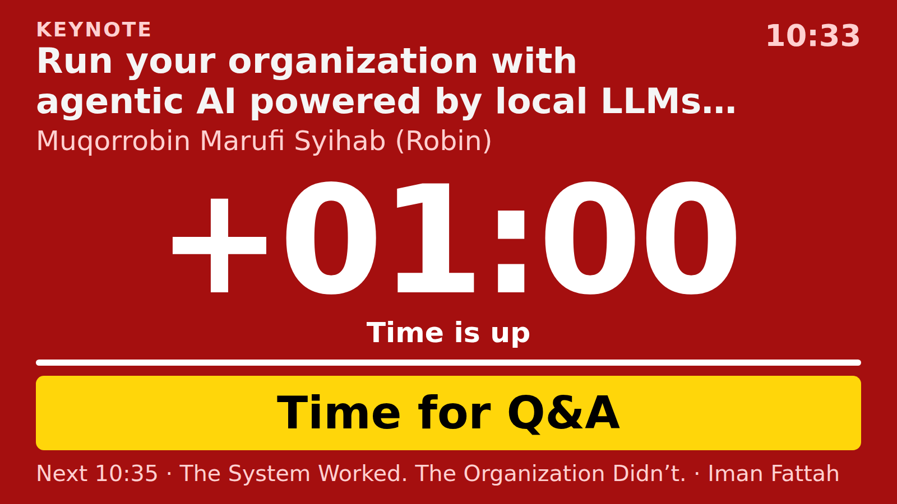
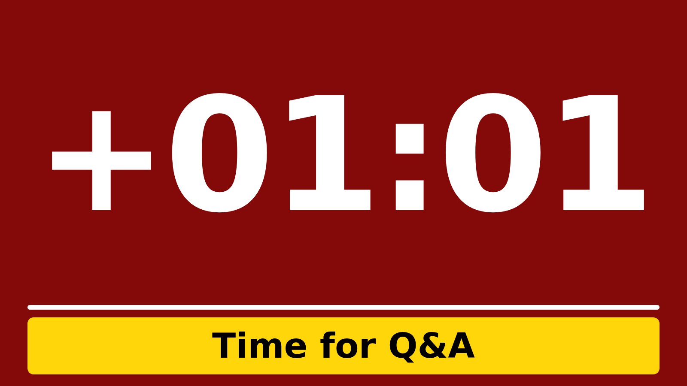
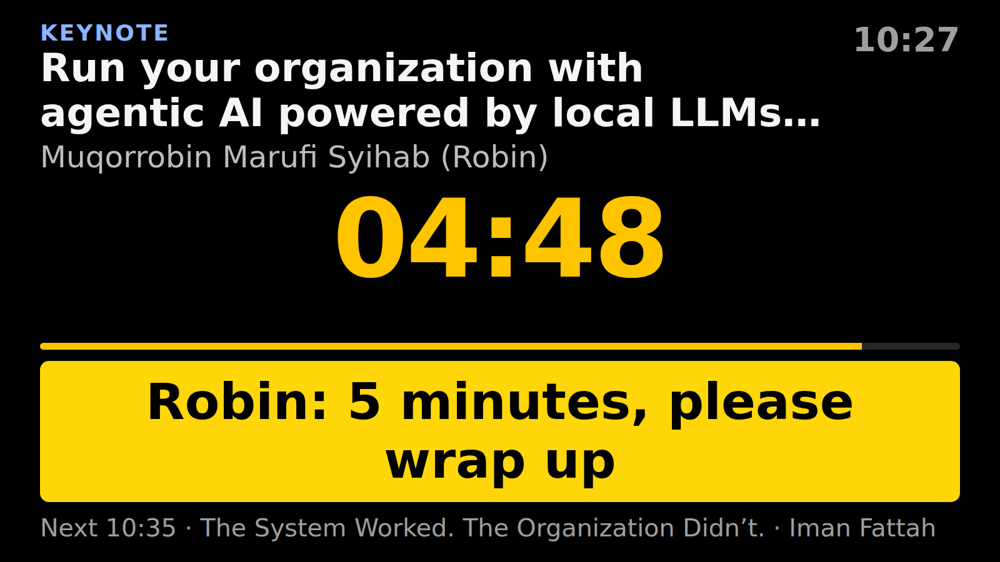
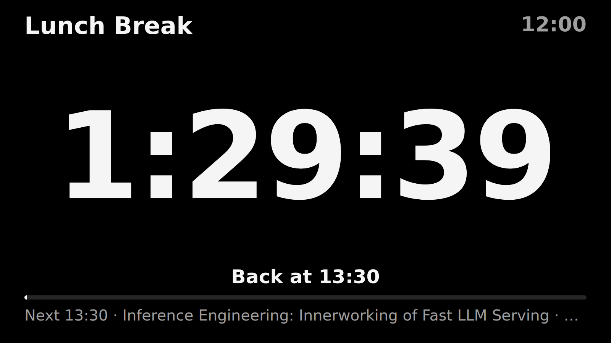
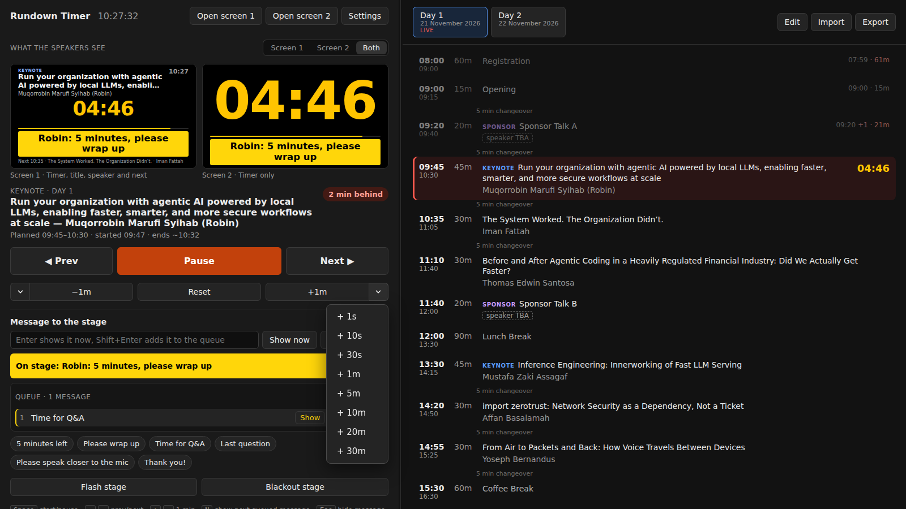
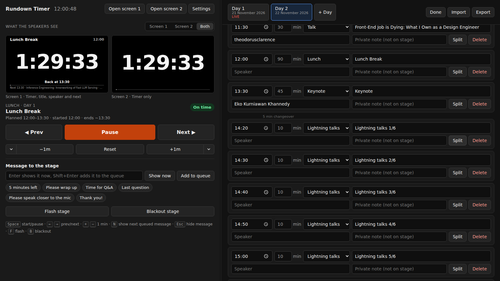
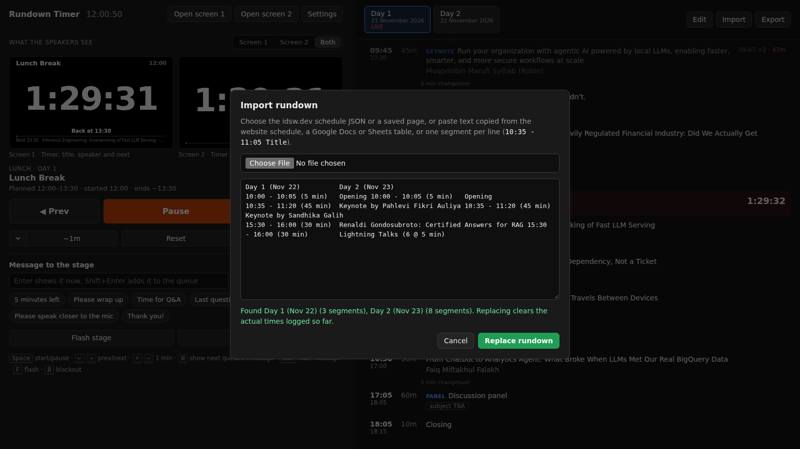

# Rundown Timer

A stage timer for IDSW. You run the controller on your laptop. Speaker screen 1 shows the countdown, the current talk and what comes next. Speaker screen 2 shows only the countdown. Both show the messages you send. It works offline and has no dependencies.



Playwright recorded this run against the IDSW 2026 rundown, with the browser clock set to 21 November from 07:59. Registration, Opening and Sponsor Talk A run first, then the keynote starts 2 minutes late. Queued cues go to the stage, `+ 30s` gives the speaker 30 seconds back, and the timer runs into overtime with a flash. Lunch then shows when people should be back.

Videos of the same run: [controller](docs/media/controller.mp4), [screen 1](docs/media/screen-1.mp4), [screen 2](docs/media/screen-2.mp4).

| Screen 1 | Screen 2 |
| --- | --- |
|  |  |
|  |  |
|  |  |

The controller with the `+` menu open, one cue on stage and one still in the queue:



Edit mode, after splitting the Day 2 lightning block into six talks:



Importing last year's Google Docs table, which had both days side by side:



## Run it

```sh
cd rundown-timer
pnpm start         # http://127.0.0.1:4321
pnpm test
```

You need Node.js 20 or newer and pnpm. The app has no dependencies, so there is nothing to install. The `packageManager` field pins pnpm 11.25.0 for Corepack. Set `PORT` or `HOST` to change the address. Use Chrome or Edge on the event laptop.

### On the homelab

```sh
HOST=192.168.1.6 PORT=4321 nohup pnpm start > /tmp/rundown-timer-server.log 2>&1 &
```

Then open http://192.168.1.6:4321 from a LAN device. Allow the port in UFW with `sudo ufw allow in on enp4s0 from 192.168.1.0/24 to any port 4321 proto tcp comment 'rundown-timer'`. The server does not restart after a reboot.

Open the controller and both stage windows in the same browser on the same device, because they sync through that browser's `localStorage`. Browsers treat `http://192.168.1.6` as insecure, so two features stay off there: moving the stage windows onto external screens, and keeping the screens awake. Everything else works. At the event, run the server on the laptop and use `127.0.0.1`.

## Event-day setup

1. Connect both stage screens to the laptop and set them to extend the desktop, not mirror it.
2. Open http://127.0.0.1:4321 and click **Open screen 1** and **Open screen 2**.
3. In Chrome or Edge, allow window management when asked, and each window moves to an external screen. In other browsers, drag each window to its screen.
4. Double-click a stage window or press `F` to make it fullscreen. The mouse pointer hides after 2 seconds.

The stage windows read the controller's state from the browser's `localStorage`. They need the same browser profile and the same address as the controller. The timer stores start timestamps, not ticks. Reloading a window or restarting the browser keeps the running time.

## Controller

| Key | Action |
| --- | --- |
| `Space` | Start, pause or resume |
| `→` / `←` | Load the next or previous segment, paused |
| `Shift` + `→` | Load the next segment and start it |
| `+` / `−` | Add or remove 1 minute |
| `N` | Show the next queued message |
| `Esc` | Hide the stage message, also while typing in the message box |
| `F` | Flash both stage screens |
| `B` | Black out both stage screens, or end the blackout |

The `−1m` and `+1m` buttons change the running timer by a minute. The chevron next to each opens a menu with 1s, 10s, 30s, 1m, 5m, 10m, 20m and 30m. The line under the current segment shows the total change, such as "adjusted +1 min 30 s". Reset clears it.

Click a segment in the rundown to load it. If a timer is running, the controller asks first. The label next to the current segment shows how far the day runs behind or ahead of the planned times. For a running segment it compares the projected end with the planned end. For a loaded one it compares now with the planned start.

The rundown shows each segment's actual start, how many minutes late it started, and how long it ran. The changeover gaps between segments come from the start times.

Drag the line between the two panels to resize them. Arrow keys move it in 40 px steps when it has focus, and a double-click resets it. Each device remembers its own width.

### Messages

Type a message and press `Enter` to show it on stage right away, or click a preset. `Shift` + `Enter` or **Add to queue** saves it for later, so you can write a speaker's cues before the talk. **Show next** or `N` shows the first queued message. **Show** on a row shows that one. A shown message leaves the queue. The arrows reorder the queue. The controller saves the queue with the rest of the state, so it survives a reload.

## Stage screens

Screen 1 shows the segment kind, title, speaker, wall clock, timer, status, progress bar and the next segment. Screen 2 shows only the timer and the progress bar. Messages and the overtime colours appear on both. Settings can switch either screen between the two layouts, and open windows change right away.

The preview at the top of the controller shows what the speakers see. Pick Screen 1, Screen 2 or Both above it. Each preview uses that screen's layout and shows messages, flashes and blackouts the way the stage screens do. Each device remembers its choice.

- The timer turns yellow at 5 minutes left and red at 1 minute. Change both in Settings. If a segment is not longer than a threshold, that colour starts at half time instead, so a 5-minute lightning talk turns yellow at 2:30 instead of from the start.
- At zero the screen turns red and counts overtime as `+01:23`.
- Keynotes, sponsor talks, lightning talks and panels get a label above the title. Titles longer than two lines get cut off.
- Breaks show `Back at 13:32`, based on the time left.
- Segments with 0 minutes, such as a closing with no end time, count up.
- Messages appear in a yellow box that blinks for 3 seconds. Edit the presets in Settings.
- **Flash stage** or `F` blinks both screens white three times over 3 seconds, to catch a speaker who isn't looking at the timer. A reload does not replay it, and a blackout hides it.
- The timer takes the space that the title and message leave, and it shrinks for longer values such as `+01:23` or `1:30:00`.

## Rundown data

On first run the app loads the IDSW 2026 schedule from `src/idsw-2026.js`, the same JSON the idsw.dev schedule uses. **Import** accepts:

- the idsw.dev schedule JSON, or a file from **Export**, which writes the same format,
- the idsw.dev page saved as HTML, or its schedule section,
- text selected and copied from the website schedule,
- a table pasted from Google Docs or Sheets, including the two-days-side-by-side layout from 2025,
- CSV, or one segment per line such as `10:35 - 11:05 Talk title`.

`Lightning Talks (6 @ 5 min)` in pasted text becomes six 5-minute segments. For a lightning block without a count, click **Edit**, then **Split** on the block.

In edit mode you can change times, durations, kinds, titles and speakers. Changing a start time re-sorts the day. Private notes stay on the controller and never appear on stage. A `pending` value from the schedule JSON shows as "speaker TBA". It clears when you fill in the missing speaker or title, or split the block.

Importing or restoring the IDSW rundown replaces the current rundown and clears the logged actual times. Export a copy first if you need them.

## Code

- `src/core.js` holds the parsing, timer math and state changes. It has no DOM code, and `test/core.test.js` covers it.
- `src/controller.js` renders the controller. Every change goes through `commit()`, which saves to `localStorage`.
- `src/viewer.js` renders a stage screen. It re-renders on the `storage` event and every 200 ms. The `screen` URL parameter picks the layout from Settings. The controller's previews are the same page in iframes.
- `src/import.js` turns pasted HTML and CSV into text for the parser.
- `server.mjs` serves `index.html`, `viewer.html` and `src/`, and nothing else.
